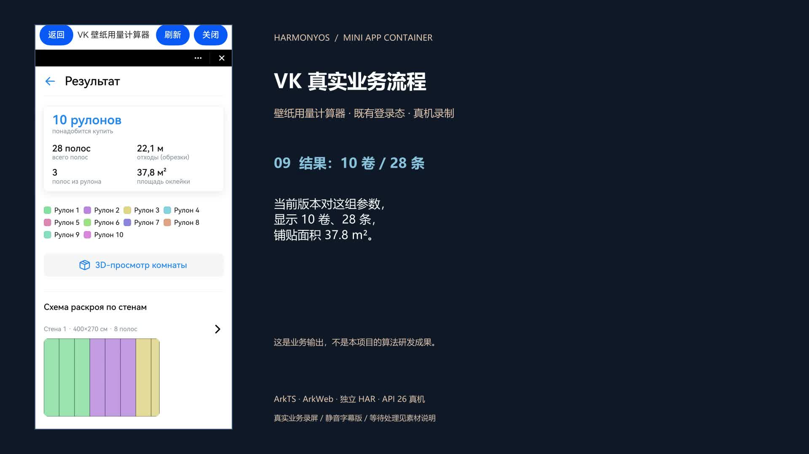
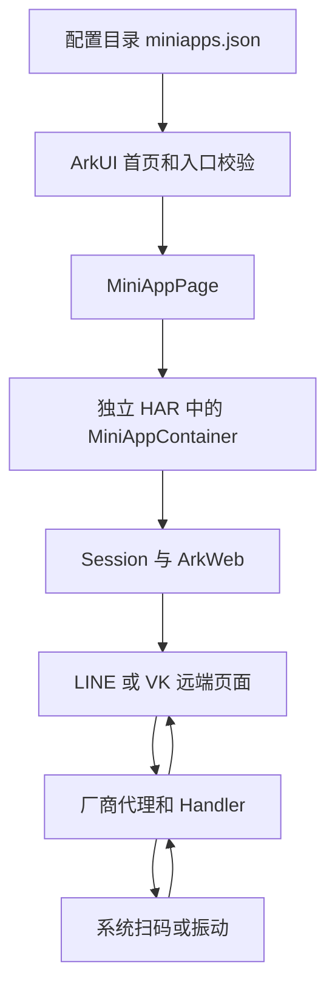

# 鸿蒙小程序容器实战 01 从新宿主到 LINE VK 业务闭环

新建一个 HarmonyOS 工程，打开一个网页，往往只需要很少的代码。可如果目标是加载 LINE 和 VK 的真实小程序，再让网页调用系统扫码、振动，问题就会延伸到协议、登录、页面跳转和资源释放。

这次我基于已有 AtomicMPSDK，开发了一个精简的 ArkTS 宿主，通过独立 HAR 接入 SDK。最终跑通了两类 API 测试入口，以及 LINE 天气和 VK 壁纸用量计算器的选定业务流程。

这一篇先把项目的主线讲清楚，后续再展开构建、登录和桥接的具体实现。

先看最终业务画面：下面是 VK 计算结果的真机录屏帧，左侧保留宿主工具栏与实际业务页，右侧是后期添加的讲解字幕。



这张图展示容器承载结果；扫码和振动使用独立的 API 测试入口验收。[两段完整视频与离线展示包](https://github.com/lichenyang5/harmony-miniapp-container/releases/tag/showcase-v1.0.0)可以先下载体验，再对照后面的实现。

## 先给项目一个可验收的目标

刚开始做迁移，很容易把源工程里能看到的模块都搬过来：账号、广告、传感器、卡片、完整应用目录，再加上一套保活栈。模块越多，构建失败时越难判断到底是哪一层出了问题。

我先把目标收敛为一条能检查的链路：

```text
新宿主 → 独立 HAR → 真实小程序 → 系统能力 → 厂商格式回包
```

首版选择 LINE WEB 扫码、VK 扫码与振动，同时补上返回、刷新、关闭和错误展示。等能力链路可用，再选择真实业务应用验证容器操作。

当前工程是普通 HAP，`installationFree: false`，最低 API 24，已在 API 26 真机运行。元服务发布不在本次目标内。先明确这一点，可以让构建和验收都围绕实际交付形式展开。

## 把宿主与 SDK 的责任分开

我希望宿主负责产品入口，SDK 负责运行能力。这样换一个首页，不需要跟着改扫码 Handler；换一个业务小程序，也不需要重新组织整套 WebView 实现。



这一层划分落实到代码后，宿主主要做四件事：读取目录、构造启动信息、选择 Adapter、处理容器事件。SDK 的 core、web、vendors 和 capabilities 则保留原有实现。

几个术语可以对应到本工程的具体对象：HAP 是安装运行的宿主应用包，HAR 是宿主集成的共享包，Session 表示一次容器运行实例，Adapter 用来选择厂商行为。同一个小程序 ID 可以先后创建多个 Session，不能用应用 ID 代替运行实例。

本次新增集中在 `entry/`、构建工具和迁移验证。原 SDK 的会话机制、厂商协议框架及原生 Handler 来自迁移源，这是理解项目贡献的基础。

## 配置目录也要有启动边界

项目使用 `miniapps.json` 描述入口。以真实 VK 业务工具为例：

```json
{
  "name": "VK 壁纸用量计算器",
  "vendor": "vk",
  "appId": "54638228",
  "url": "https://vk.ru/app54638228"
}
```

配置驱动不等于信任配置中的所有字段。首页读取时会验证厂商、ID、URL，并按厂商与 ID 去重；进入容器页时还会再次验证路由参数。

例如，当前 VK 规则要求数字 ID 和精确匹配的官方入口。LINE 则要求合法格式的 LIFF ID，与对应的 `miniapp.line.me` 或 `liff.line.me` 地址一致。

真正交给 SDK 的对象由白名单重建。下面是源码中的函数：

```typescript
export function createLaunchInfo(app: DemoMiniApp): MiniAppInfo {
  if (!isDemoMiniApp(app)) throw new Error('Invalid mini app entry');
  return {
    appId: app.appId,
    vendor: app.vendor,
    url: app.url,
    isSSLIgnore: false,
    isOpenGeolocation: false
  };
}
```

这个函数没有直接展开 `...app`。即使路由对象里夹带脚本、凭据或 SSL 豁免字段，它们也不会因此进入 SDK。宿主确有转场图标和调试脚本需求时，再由受控代码单独添加。

这只是宿主启动参数的边界，不构成任意网页的完整安全沙箱。

## Adapter 负责选择厂商行为

容器页根据厂商创建适配器，源码节选如下：

```typescript
this.adapter = params.vendor === 'line'
  ? new LineAdapter({ mode: LineMode.WEB })
  : new VkAdapter();
```

这里显式写出 LINE WEB 模式很有意义。它决定了当前选择网页运行路径，而不是 CLIENT 账号路径。后续讨论 LINE 登录和能力支持时，都要从这个配置出发。

宿主统一使用 `MiniAppContainer`，不同厂商的导航、协议和 Handler 由 SDK 的对应模块处理。统一的是承载入口，不是把所有厂商的成功、取消和错误强行变成同一种结果。

## 初始化要放在应用生命周期里

我把初始化接入 `EntryAbility.onCreate`：

```typescript
MiniAppSDK.initialize(this.context.getApplicationContext());
```

这样 SDK 可以及时建立应用级生命周期监听。容器页挂载后再创建独立会话，移除时交给容器关闭会话。

这里需要区分三个状态：WebView 已绑定导航控制器、网页已经显示、小程序业务已经可用。宿主的 `onNavigationReady` 只说明拿到了导航句柄，不能顺手把它当作“远端业务加载成功”。

项目里 `ready` 用来控制刷新按钮是否可用，业务是否真正成功仍由页面内容、操作结果和日志共同判断。

## 用两种业务检查容器是否真的可用

API 测试入口能证明扫码或振动链路，但真实业务还会带来表单、iframe、页内状态和历史恢复。

因此我另外选择了两个应用：

| 应用 | 本次操作 | 检查重点 |
| --- | --- | --- |
| VK 壁纸用量计算器 | 参数填写、计算、二维详情、返回、关闭、重开 | 页面导航和结果恢复 |
| LINE Yahoo! 天气 | 地区搜索、保存、预报切换、刷新、重开 | 页内状态和偏好恢复 |

VK 业务复用已有官方登录态；LINE 天气本次没有要求登录。两者的页面和业务算法属于第三方，我负责的是容器接入、操作链路和验证。

## 这次架构取舍带来的收获

精简宿主让问题更容易定位。构建问题先看 HAR 和依赖解析；登录问题先看官方网页和模式；原生调用问题再看代理与 Handler；返回异常则检查厂商导航和宿主退出。

当前还没有接入跨小程序跳转和多应用保活栈。后续扩展时，可以继续沿用现有层次增加宿主能力，而不必在一个页面里同时堆叠目录、账号、协议和系统调用。

## 源码与下一篇

- [宿主 MiniAppPage](https://github.com/lichenyang5/harmony-miniapp-container/blob/showcase-v1.0.0/entry/src/main/ets/pages/MiniAppPage.ets)
- [目录与启动信息校验](https://github.com/lichenyang5/harmony-miniapp-container/blob/showcase-v1.0.0/entry/src/main/ets/model/MiniAppCatalog.ets)
- [迁移来源与范围](https://github.com/lichenyang5/harmony-miniapp-container/blob/showcase-v1.0.0/docs/migration.md)
- [下一篇 独立 HAR 构建与宿主集成](https://github.com/lichenyang5/harmony-miniapp-container/blob/main/docs/blog/02-har-build-and-integration.md)
