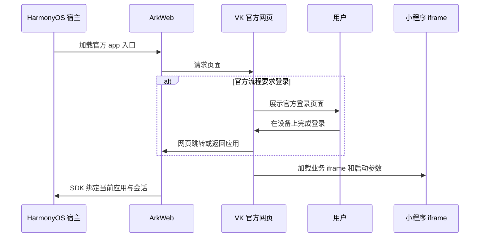

# 鸿蒙小程序容器实战 03 VK 官方网页登录与登录态复用

在容器里接入 VK 小程序，登录经常会被描述成一句“打开登录页，成功后加载应用”。实际实现要回答的事情更多：登录由谁完成，目标地址如何恢复，什么时候才算进入了小程序，以及原生桥接该接管哪些请求。

本项目选择默认 `new VkAdapter()`，沿用 VK 官方网页登录。宿主承载网页，原 SDK 提供登录跳转辅助、iframe 识别和部分原生能力代理。账号、密码与验证码由用户在官方页面输入。

## 先分清三个容易混在一起的状态

| 状态 | 具体含义 | 本工程中的用途 |
| --- | --- | --- |
| 官方网页登录态 | 平台接受用户登录，并按自身规则维持 Web 会话 | 官方页面访问与登录复用 |
| 小程序启动身份 | 当前官方页面承载的是哪个应用及其启动上下文 | 启动上下文记录和导航边界 |
| 原生能力绑定 | 当前 Session 注册了哪些原生 Handler | 扫码、振动等调用与回包 |

看到应用 ID，不等于完成账号认证；系统扫码能够打开，也不等于宿主拿到了用户的 OAuth Token。

把这三层分开，后面的代码就比较容易读懂。

## 从官方应用入口开始

宿主目录使用 `https://vk.ru/app<ID>`，并检查 URL 与数字 ID 完全对应。这个入口会进入 VK 的顶层网页，再由官方页面加载实际业务 iframe。



打开一个自己写的普通 H5 页面，无法替代这条链路。官方顶层页、业务 iframe 和实际账号状态都可能影响小程序是否能够工作。

## SDK 如何辅助登录后回到应用

已有 SDK 在 `VkVendor.ets` 中保留了一段顶层登录辅助脚本。它先检查当前页面是否属于 VK 官方域名，再判断是否为目标应用。

对于 `m.vk.ru` 上的目标页，如果还没有本地导航标记，也没有观察到目标小程序 iframe，脚本会保存当前地址，再使用 `location.replace` 转到移动网页登录入口。

保存的两个键是：

```text
vk_app_pending       待返回的应用地址
vk_app_logged_in     导航辅助标记
```

脚本将待返回地址写入当前源下的 `sessionStorage` 和 `localStorage`。之后观察 `/feed` 路径，读取待返回地址、清理 pending，再跳回目标应用。

这是源码逻辑的简化表达，不是可直接复制的完整实现：

```text
目标移动应用页
    有导航标记或已观察到应用 iframe → 继续
    否则 → 保存当前地址 → 打开官方登录页

观察到 feed 路径
    有 pending → 设置辅助标记 → 清理 pending → 返回应用
```

同源限制很重要。这段辅助流程只处理移动域名上的特定场景；桌面或其他官方域名的跳转继续由 VK 自身处理，没有假设各域名可以直接共享 localStorage。

## 页面标志不能充当认证结果

变量名里虽然有 `logged_in`，但它是网页导航辅助标志。观察到 `/feed` 路径也是启发式判断，不能代替平台对账号和授权的验证。

标记可能残留，登录态可能过期，远端页面结构也可能变化。因此，我验收时会继续检查实际小程序页面和业务操作，而不会只看到这个存储值就宣布“登录成功”。

当前 VK 接入没有配置宿主侧的 Cookie 导出、Token 注入或自建登录凭据仓库。官方 Web 会话仍由平台流程与 WebView 的正常网页存储机制参与维护，具体过期和风控行为由平台决定。

若继续完善这段辅助脚本，值得补的点包括 pending 地址重新校验、残留标记恢复、轮询清理，以及更明确的失败和取消状态。这些是后续改进方向，不应混写成当前已完成能力。

## 登录之后还要识别真正的小程序

官方页面可以是首页、登录页、消息页，也可以是小程序承载页。SDK 使用 `VkMiniAppIdentity` 将初始入口意图与实际应用联系起来。

顶层脚本扫描 iframe，寻找具有 `vk_app_id`、`vk_user_id` 和 `sign` 的 HTTPS 地址。在符合唯一候选等条件时，上报应用 ID，并与当前入口进行匹配。

实现还处理了登录后可能出现的 `/games/app<ID>` 路径，将它归一到同一个应用身份。否则应用 ID 虽然没变，导航逻辑却可能把登录前后当成不同目标。

原生侧接受匹配后会记录 `IDENTITY_ACCEPTED`。这个事件表示当前会话接受了入口与页面身份的对应关系，**不表示 SDK 验证了 `sign` 的密码学签名**。

普通能力请求还要经过 iframe 来源检查和 Handler 查找，并不是先通过 `IDENTITY_ACCEPTED` 才统一获得原生能力授权。身份匹配、消息来源和方法分发分别承担不同职责。

`VkLaunchParams` 保存当前上报参数的快照，保留顺序、重复键和空值。它服务于会话上下文，不应被当作宿主后台登录凭据。

## 当前没有接管原生 Token 授权

`VkAdapter` 中确实存在 `onAuthTokenRequest` 扩展点，也保留了 `VkAuthTokenHandler` 的实现。但当前宿主没有提供这个回调，`VkBinding` 中也没有注册该 Handler：

```typescript
// VkBinding 中的源码节选
// new VkAuthTokenHandler(session, adapter),
```

所以，本项目的登录不能写成“原生 OAuth 授权中心已接入”。默认处理路径是：受支持且已注册的能力由原生处理；未被原生接管的请求继续进入官方网页链路，是否成功仍由官方环境决定。

扫码、振动属于前一种；官方网页登录属于平台 Web 流程。它们可以在同一个容器中协作，但职责不同。

## 跨 iframe 消息如何找到正确来源

SDK 在 VK 接收文档里监听小程序消息，核对 `event.source` 是否对应页面中的 iframe，再核对 iframe 地址与 `event.origin`，同时检查启动参数结构。

原生接管请求后，网页保存来源窗口和来源 origin。回包使用保存的目标发送，避免因为页面中有多个窗口，就把结果广播给所有 iframe。

这些检查能约束正常消息的路由来源，但没有提供进程隔离或 Cookie 隔离，也不能替代服务端验签。

现有 SDK 还包含 AndroidBridge 与平台兼容补丁，其中会调整 iframe 可见的 `vk_platform`；`VKWebAppGetLaunchParamsResult` 响应中的同类字段重写则处于禁用状态。这两个通路应分别阅读。对启动参数敏感的业务仍可能不兼容，不能根据两个已通过的应用推导全面兼容。

## 转场图标为什么放在宿主定制

项目里还有一个很直观的改动：将登录后加载页中央的小羊图标替换为本地图片。

我没有把它写入 VK 协议模块，而是在宿主通过 `jsOnDocStart` 注入受限脚本：只处理官方顶层页、当前应用路径，只有中心区域恰好匹配一个候选图片时才替换；退出页面时断开观察器。

它不进入业务 iframe，也不负责判断登录成功。远端布局变化后需要复查匹配条件。这类 UI 定制与账号流程分开，后续维护会更清晰。

## 本次登录验证支持什么结论

用户已在设备上的 VK 官方页面完成登录，API 测试中心可正常加载。后续业务验收与录屏复用该登录态，完成计算、二维详情、返回、关闭与重开历史恢复。

这支持“当前环境下官方网页登录与选定小程序承载可工作”。全新业务登录、清理状态后的恢复和登录失效异常路径，需要另外验收。

## 登录链路卡住时怎样定位

排查时先确定停在哪一层，再决定查看网页还是桥接代码。下面是依据当前实现整理的排查路径，不代表本项目已经遇到或复现了其中每一种故障。

| 现象 | 优先核对 | 可以缩小到的范围 |
| --- | --- | --- |
| 一直停在官方登录页 | 是否由用户完成登录、页面是否提示验证码或其他要求 | 官方账号流程，先不归因于扫码 Handler |
| 登录后到达首页，没有回到应用 | 当前 hostname、pending 是否在同一源、是否进入辅助脚本分支 | 返回地址与跳转辅助；有标记也不能直接判断登录有效 |
| 已回到 app 路径，但业务未显示 | 是否加载出目标 iframe、是否只有一个合格候选 | 远端页面加载、启动参数或应用身份匹配 |
| 出现 IDENTITY_ACCEPTED，但业务仍异常 | 实际业务页面和失败操作，是否依赖未验收 API | 身份匹配已完成，业务能力仍需继续检查 |
| 业务能操作，只有扫码没有回包 | 请求是否进入原生、同一请求是否完成、文档是否已变化 | 转向桥接和生命周期排查，见下一阶段的回包分析 |

公开排障记录只保留 hostname、状态码和必要的关联标识。不要直接粘贴完整 iframe 地址或启动参数，其中可能含有用户标识和签名；现有 Debug 输出也应先脱敏再分享。

面试时可以用这条链路解释接入职责：我负责让官方页面在新宿主中完成跳转与承载，并验证选定能力；平台负责接受账号认证，已有 SDK 负责协议适配与会话绑定。

## 源码与下一篇

- [VK 网页脚本与 Binding](https://github.com/lichenyang5/harmony-miniapp-container/blob/showcase-v1.0.0/mpsdk/src/main/ets/vendors/vk/VkVendor.ets)
- [应用身份匹配](https://github.com/lichenyang5/harmony-miniapp-container/blob/showcase-v1.0.0/mpsdk/src/main/ets/vendors/vk/VkMiniAppIdentity.ets)
- [启动参数快照](https://github.com/lichenyang5/harmony-miniapp-container/blob/showcase-v1.0.0/mpsdk/src/main/ets/vendors/vk/VkLaunchParams.ets)
- [宿主转场图标定制](https://github.com/lichenyang5/harmony-miniapp-container/blob/showcase-v1.0.0/entry/src/main/ets/model/VkTransitionIcon.ets)
- [下一篇 LINE WEB 模式与原生扫码联调](https://github.com/lichenyang5/harmony-miniapp-container/blob/main/docs/blog/04-line-web-and-scan.md)
