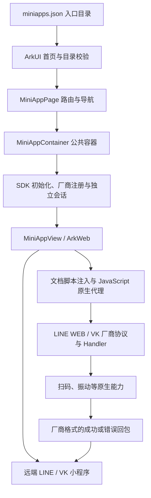

# 项目展示与面试说明

## 项目定位

**项目名称：HarmonyOS 多厂商 H5 小程序容器集成与原生能力桥接。**

基于已有 AtomicMPSDK，将其迁移为独立 HAR，由新建的 HarmonyOS 普通 HAP 宿主消费。宿主通过统一容器加载选定 LINE/VK 小程序，并将部分网页 API 接入系统扫码、振动等原生能力，完成构建、部署、调用与回包的验证闭环。

技术栈：ArkTS、ArkUI、ArkWeb、HAR/HAP、厂商 JavaScript 协议桥接、Scan Kit、振动能力、Hvigor、OHPM、Node.js 测试、HDC 真机调试。

当前产品配置是 `installationFree: false` 的普通 HAP，最低 API 24，已在 API 26 真机验证。本项目不包含元服务发布、应用商店上架或完整厂商客户端兼容。

## 当前能打开什么

当前配置包含**两个真实平台 API 测试小程序和一个真实业务工具**：

| 入口 | 实际完成情况 | 尚未证明的能力 |
| --- | --- | --- |
| LINE `2012241484-PibjtMII`，WEB 模式 | 远端测试台加载、LIFF 初始化；通过 Debug 面板调用真实 `scanCodeV2`，系统扫码、取消、重试及成功文本回传通过 | LINE 账号登录、CLIENT 模式及其他业务小程序 |
| VK `54769936` | 用户完成官方登录，远端测试中心加载；原生扫码、振动及对应成功/错误回包通过 | 完整 VK API 兼容 |
| VK `54638228`，壁纸用量计算器 | 复用已有登录态，完成参数、计算、二维详情、返回、关闭及重开历史恢复 | 全新登录、3D 模型、广告交互及其他业务应用 |

容器和桥接链路已实际运行；除 API 测试台外，真实计算工具已完成一条业务演示流程。该远端业务及计算算法属于第三方，本项目实现其容器接入和验证。完整操作卡见 [vk-business-demo.md](vk-business-demo.md)。

目录校验没有写死这些 ID。可在 `entry/src/main/resources/rawfile/miniapps.json` 增加其他满足当前规则的真实入口，再重新构建尝试：

- VK：数字 ID，地址必须是 `https://vk.ru/app<ID>`。
- LINE：符合格式的真实 LIFF ID，地址为 `https://miniapp.line.me/<ID>` 或 `https://liff.line.me/<ID>`。
- 当前没有手输网址入口，也不接受任意 H5、别名或自定义业务域名作为目录启动地址。目录通过只代表满足宿主启动规则，不保证远端可访问、账号有权限或业务 API 已兼容。

宿主目前未接入 `onOpenMiniApp` 的跨小程序跳转处理，也未实现多应用保活栈。因此，其他小程序若依赖这些能力，需要额外接入和验收。

## 项目架构

| 层次 | 主要位置 | 责任与归属 |
| --- | --- | --- |
| 宿主交互 | `entry/src/main/ets/pages/` | 本项目新增首页、容器页、返回/刷新/关闭及错误展示 |
| 启动边界 | `entry/src/main/ets/model/MiniAppCatalog.ets` | 本项目新增目录校验、去重、ID/URL 对应校验与启动参数白名单 |
| 应用初始化 | `entry/src/main/ets/entryability/EntryAbility.ets` | 本项目接入应用级 SDK 初始化，使其及时订阅生命周期 |
| 容器与会话 | `mpsdk/src/main/ets/core/`、`web/` | 继承原 SDK 的会话、ArkWeb、脚本安装、导航和生命周期实现 |
| 厂商协议 | `mpsdk/src/main/ets/vendors/line/`、`vk/` | 继承原 SDK 的 Adapter、代理与协议处理；本项目选择并联调 LINE WEB / VK |
| 系统能力 | `mpsdk/src/main/ets/capabilities/` | 继承原 SDK 的原生能力实现；本项目选定扫码、振动验收 |
| 构建与依赖 | `tools/`、根 `hvigorfile.ts` | 本项目新增源码/打包 HAR 切换、工具链配置、签名隔离与失败恢复 |
| 测试与证据 | `tests/`、`docs/validation.md` | 组合继承测试与新增迁移测试，分别记录编译、平台替身和真机结果 |

构建产物链路：`mpsdk 源码 → bytecode HAR → libs/mpsdk.har → entry 文件依赖 → HAP → 真机`。宿主最终依赖 `file:../libs/mpsdk.har`，已验证二进制 HAR 消费，不能把仅依赖源码模块的构建当作此项完成。

## 三条核心运行链路

### 启动与退出

`EntryAbility.onCreate` 初始化 SDK；首页读取并校验目录；容器页复核路由并选择 Adapter；通过 `MiniAppContainer` 创建会话和 WebView。返回键先交由 SDK 导航控制器处理，无可返回内容时关闭宿主页；容器卸载负责关闭会话。

### 网页调用原生能力

小程序调用厂商 JavaScript API，SDK 注入的代理将受支持请求送入对应 Handler；原生能力完成后，SDK 根据请求上下文恢复厂商响应格式并回传网页。VK 振动非法参数、扫码取消，以及 LINE 扫码取消具有不同错误语义，不能统一返回一个布尔值。

LINE 选定测试台的扫码卡额外检查 `inLineClient`，因此 WEB 模式会被测试台自身拦截。本项目增加 Debug 诊断面板，等待 LIFF 就绪后由用户点击调用真实 `scanCodeV2`，以验证代理链路；没有伪造客户端状态，也没有把模拟结果当作真机成功。

### 构建与复现

构建脚本配置 DevEco SDK、JBR 与 TypeScript，先同步源码依赖并生成 HAR，再切换到打包 HAR 同步构建宿主。失败路径恢复打包依赖配置；根构建逻辑检查依赖状态，防止清单已切换但实际仍解析到源码。签名从被忽略的 `.local/signing.json` 读取，公开模板只保留占位符。

## 核心技术难点与本次贡献

| 难点 | 本次完成的工作 | 证据与解释边界 |
| --- | --- | --- |
| 源码迁移成功不等于 HAR 可交付 | 保留必要资源与静态依赖，适配工具链，打通源码打包及二进制消费，增加依赖状态检查和构建失败恢复 | HAR、打包 HAR 宿主签名构建均通过；没有宣称完成 SDK 裁剪或所有编译告警治理 |
| 多厂商调用与回包语义不同 | 复用原 SDK Adapter/Handler，完成宿主接入、协议联调及实际网页结果核对 | LINE 扫码、VK 扫码/振动的成功、取消重试及 VK 非法参数分支通过；协议框架不是此次从零设计 |
| WEB 环境与官方客户端条件不同 | 定位 LINE 测试台前置条件，新增受 Debug 和 LIFF ID 限制的诊断入口，验证真实 API | LINE WEB 原生扫码通过；不推导出 LINE 登录或 CLIENT 模式通过 |
| 生命周期与异步结果可能跨页面 | 及时初始化 SDK，接入导航、卸载和回调有效性判断，复用 SDK 会话隔离机制 | 一次前后台恢复、十轮快速挂载关闭通过；迟到结果有替身回归，尚无对应真机场景验收 |
| 启动参数与宿主定制需有边界 | 校验厂商、ID 与官方 URL；白名单构造启动信息；将 VK 转场图标替换限定于目标官方顶层页 | 不透传目录中的任意脚本、凭证、SSL 豁免；图标替换有范围和清理测试，远端布局变化仍需复验 |
| 测试通过范围容易被夸大 | 单独建立迁移回归入口，保留原 SDK 失败记录，按证据层次维护验收文档 | 44 项迁移回归通过，含继承与新增测试；不是全量 SDK 测试通过，也不是 44 个真机用例 |

## 我的实际贡献如何表述

当前代码和本次记录能支持的职责是：**负责新宿主开发、已有 SDK 的独立 HAR 迁移与集成、选定协议能力联调、构建与签名配置隔离、迁移回归及真机验收。**

可具体展开为：

1. 设计并实现精简宿主的目录加载、启动校验、Adapter 选择和导航交互。
2. 接入应用级初始化和容器生命周期，确保宿主遵循已有 SDK 的会话契约。
3. 建立独立 HAR 生成与消费流程，解决本机工具链、依赖切换及失败恢复问题。
4. 增加 LINE WEB 诊断入口、真实桥接链路回归、目录校验和构建失败等测试。
5. 联调 LINE 扫码、VK 扫码/振动，核对网页结果与 SDK 日志；官方登录、扫码动作由用户在设备上完成。
6. 实现 VK 登录后加载图标的宿主定制，并补充验证与来源文档。
7. 筛选并接入真实 VK 业务工具，验证两步表单、二维业务详情、两种返回、关闭释放与历史恢复，补齐可重复的面试流程。

原 SDK 中的会话状态机、厂商协议、脚本注入框架及原生 Handler 均来自迁移源。本次迁移记录不能证明这些模块最初由本人设计。如果本人也参与了源工程开发，可在核对源提交、具体模块职责后单独补充；当前简历采用“基于已有 SDK 完成……”的表述。

## 验证与当前完成度

| 验证层次 | 已有结论 |
| --- | --- |
| 构建 | API 24 HAR、打包 HAR 宿主签名构建通过；ArkTS 测试编译通过 |
| 自动回归 | 44/44 项迁移回归通过，使用真实 SDK 及平台替身；继承的其他套件仍有已记录失败 |
| 真机网页与原生链路 | 两个选定 API 测试小程序加载；LINE 扫码、VK 扫码与振动的选定分支通过 |
| 真机业务流程 | 壁纸用量计算器的计算、二维详情、返回、关闭、重开与历史恢复通过；复用已有 VK 登录态 |
| 生命周期 | 一次 VK 前后台恢复、十轮快速挂载关闭、一次 VK 关闭后打开 LINE 通过 |
| 尚待扩展 | 更多业务小程序、业务入口全新登录、LINE 登录、跨小程序跳转、断网恢复、长期内存与性能、真机迟到回包场景 |

这里的十轮是“快速挂载后关闭”，没有逐轮等待完整网页加载，不能写成十轮业务稳定性测试。已有单次调用耗时不作为性能优化指标。完整验收记录见 [validation.md](validation.md)。

## 面试展示顺序

优先使用 [真实业务操作卡](vk-business-demo.md)，完成“打开 → 参数 → 计算 → 二维详情 → 返回 → 关闭 → 历史恢复”。另用以下 API 演示说明原生桥接（建议 3～5 分钟）：

1. 首页说明宿主与独立 HAR 的边界，展示两类厂商入口。
2. 打开 VK 测试小程序；如需登录，由本人在官方页面完成。展示转场图标和测试中心。
3. 调用振动，展示成功回包；输入非法参数，展示厂商格式错误。
4. 打开扫码页，先取消再重新扫码，展示实际识别内容。使用不含个人信息的测试二维码。
5. 返回宿主，打开 LINE；在 Debug 面板展示真实扫码及结果。说明此面板解决的是测试台 WEB 环境限制。
6. 展示一次返回/刷新/关闭，最后用架构图解释桥接、会话和打包路径。

录屏前自行确认网络和远端入口可用，避免展示账号、验证码、通知及个人资料。此处为演示脚本，目前尚未完成对外演示录屏。

## 高频追问

**是否只有 API Demo？** 不是。API 测试台用于验证原生调用和回包；另已接入真实 VK 壁纸用量计算器，完成已有登录态下的计算、二维详情、返回、关闭及历史恢复。其他业务小程序和完整厂商兼容仍需分别验证。

**能否支持任意 VK/LINE 小程序？** 不能据当前结果作此保证。宿主允许增加符合启动规则的其他 ID，但远端登录策略、iframe 行为、权限与未支持 API 都可能影响结果，需要逐应用验收。

**SDK 生命周期机制是你写的吗？** 本次复用了已有实现；我负责将它正确接入新宿主，并通过回归与真机操作验证选定行为。若讨论内部原理，应明确“阅读并复用了什么”和“本次改了什么”。

**项目最大的价值是什么？** 把已有协议和原生能力封装接入一个可构建、可部署、可验证的新宿主，解释并验证多厂商网页到原生再回网页的完整链路，且能明确复现条件和兼容边界。
