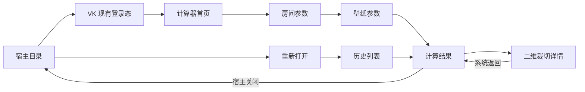

# VK 真实业务小程序演示

验证日期：2026-11-16。环境：本项目签名 Debug HAP、独立打包 HAR、API 26 真机。

## 选定应用

- 宿主名称：**VK 壁纸用量计算器**。
- 原名称：**Калькулятор обоев**。
- 应用 ID：`54638228`。
- 宿主入口：`https://vk.ru/app54638228`。
- 来源：[开发者已发布应用目录](https://pixel-and-byte.ru/apps/)，其中“Калькулятор обоев”链接指向 `https://vk.com/app54638228`。宿主采用其当前校验规则接受的 `vk.ru` 官方入口，已真机打开。

这是第三方开发者发布的实用工具，业务是根据房间和壁纸参数计算用量及裁切方案，不是 API 测试台。远端业务、计算算法及页面不是本项目开发成果；本项目贡献是将其接入 HarmonyOS 容器并验证承载、导航和退出行为。

最初候选 GoPolyana（`54621223`）虽有 SDK 身份识别事件，但本次观察时未进入可操作业务页，已从最终目录移除。这里只记录观察结果，不断言其服务永久不可用或故障原因。

## 已完成的业务闭环

| 检查项 | 本次实际结果 |
| --- | --- |
| 登录上下文 | 复用此前由用户在官方 VK 页面完成的登录态，直接进入业务；本次未重新输入账号，也未单独验证退出登录后的重登或该应用的独立授权弹窗 |
| 业务首页 | 显示应用标题、“新建计算”和“计算历史” |
| 房间表单 | 进入两步表单，使用默认矩形尺寸，操作门窗数量、滚动及下一步 |
| 壁纸表单 | 选择内置冷色纯色样式，确认卷宽/卷长与无对花模式，执行计算 |
| 结果 | 网页实际显示 10 卷、28 条、每卷 3 条、铺贴面积 37.8 m² |
| 二维详情 | 400×270 cm 墙面显示 8 条彩色裁切方案及卷号 |
| 宿主顶部返回 | 从业务子页返回结果页；日志出现 `VkNavigation.toolbarBackDecision` / `BACKED` |
| 手机系统返回 | 从二维详情返回结果页；日志出现 `VkNavigation.systemBackDecision` / `BACKED` |
| 关闭 | 顶部“关闭”返回宿主目录；日志出现 `WebView.released`、`Session.closed` |
| 重新打开 | 新会话进入首页，显示最近的 10 卷计算记录 |
| 历史恢复 | 打开“计算历史”及测试记录，重新显示同一份结果 |

本次只验证了上述单次业务流程及一次关闭重开，不是全功能验收或长期稳定性测试。44 项迁移回归仍通过，但这些 UI 操作属于人工/设备联调证据，不计入 44 项 Node 回归数量。

## 面试操作卡（约 3 分钟，不计远端加载等待）

1. 打开宿主第三个入口“VK 壁纸用量计算器”。等待网页出现“新建计算”，不要将 VK 加载图标当作打开成功。当前已有登录态；如出现官方登录页，由本人直接在手机输入凭证。
2. 点击 **Новый расчёт（新建计算）**。
3. 房间保持矩形 **Прямоугольная**；确认长 `400 cm`、宽 `300 cm`、高 `270 cm`。将门 **Двери** 和窗 **Окна** 都通过减号调到 `0`。使用虚构测试数据，不上传照片。
4. 向下滚动，点击 **Далее: параметры обоев（下一步：壁纸参数）**。
5. 选择 **Однотонные холодные（冷色纯色）**；确认卷宽 `53 cm`、卷长 `1005 cm`、**Без подгонки（无对花）**；门窗处理保持 **Авто（自动）**。
6. 点击 **Рассчитать（计算）**。等待结果 **Результат**，展示 `10 рулонов（10 卷）` 和 `28 полос（28 条）`。
7. 向下找到 **Стена 1（墙面 1）**，点击进入 **Схема стены（墙面方案）**，展示 `400×270 cm / 8 条` 的二维裁切图。
8. 使用手机系统返回键回到结果页；再进入墙面详情，用宿主顶部“返回”回到结果页。两种返回均由容器导航链路处理。
9. 点击宿主顶部“关闭”，确认回到宿主首页。
10. 再次打开该应用，点击 **История расчётов（计算历史）**，打开刚才的 10 卷测试记录，说明关闭容器后仍能恢复业务记录；最后关闭。

结果数字是当前远端版本对这组参数的实际输出，不代表本项目对装修用量算法的专业验算。演示前复核远端版本与参数，避免将其他配置的结果硬说成固定值。

## 演示时怎么讲

> 这个页面来自第三方真实 VK 小程序。我的宿主通过独立 HAR 加载它，复用官方网页登录上下文，承载两步表单、计算结果和业务内部导航。这里的计算算法不是我写的；我要展示的是 HarmonyOS 容器接入能力，以及返回、关闭、会话释放和再次进入的完整行为。扫码、振动等原生桥接另在 API 测试入口演示。

可补入简历的一条贡献：

> 接入真实 VK 壁纸用量计算小程序，完成已有登录态下的参数操作、计算结果、二维详情、宿主/系统返回、关闭释放与历史恢复验证，补齐 API 联调之外的业务承载演示。

## 当前限制与演示准备

- 本次冷启动观察到较长远端加载等待；尚未定位网络、平台或业务各自耗时。面试前检查网络，提前试开一次，不宣称加载性能已优化。
- 远端页面提示计算后可能展示广告。本次计算最终进入结果，不代表广告能力验收；不要点击广告或购买入口。
- 可选 **3D-просмотр комнаты（3D 房间预览）** 能打开页面，但本次未显示房间模型，未确定原因；不纳入通过项或面试主流程。二维裁切图已实际显示。
- 不清除 Cookie 或退出账号来制造登录演示。若需要验收全新登录，另安排本人在官方页面完成；不记录账号、密码、验证码或会话凭证。
- 不保证全部 VK 业务小程序兼容；支付、邀请、消息发送及跨小程序跳转均不在本次范围。
- 截图、UI 快照及原始日志只保存在忽略的 `.local/`。已保留结果、二维详情、返回、关闭、重新打开及历史恢复证据；尚未录制对外演示视频。

代码入口：`entry/src/main/resources/rawfile/miniapps.json`。本次复用现有 `MiniAppPage`、`VkAdapter` 与导航控制器，没有修改 SDK 协议或注入脚本来伪造业务成功。
